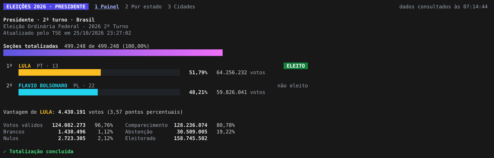
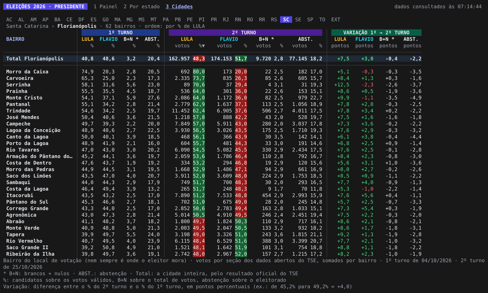

# eleicoes

Acompanha no terminal a apuração da eleição para Presidente, com os dados públicos do TSE:
painel ao vivo, tabela por estado e por cidade comparando os dois turnos e, nas cidades, o
resultado por bairro.





## Como baixar

Na página de [versões](https://github.com/alexpfx/eleicoes/releases/latest), baixe o arquivo
do seu sistema:

| Sistema | Arquivo |
|---|---|
| Windows | `eleicoes_<versão>_windows_amd64.zip` (`arm64` nos computadores com processador ARM) |
| macOS com processador Apple (M1 em diante) | `eleicoes_<versão>_macos_arm64.tar.gz` |
| macOS com processador Intel | `eleicoes_<versão>_macos_amd64.tar.gz` |
| Linux | `eleicoes_<versão>_linux_amd64.tar.gz` (ou `arm64`) |

Não é preciso instalar nada: o programa é um arquivo só, com os dados dos bairros dentro.

### Windows

1. Extraia o `.zip` e abra o `eleicoes.exe`.
2. O programa não é assinado, então o Windows pode mostrar "O Windows protegeu o computador".
   Clique em **Mais informações** e depois em **Executar assim mesmo**.

O programa fica melhor no Terminal do Windows, que já vem no Windows 11. No Windows 10,
instale-o pela Microsoft Store.

### macOS

1. Abra o `.tar.gz` (ele vira uma pasta).
2. No Terminal, entre na pasta, libere o programa e abra:

   ```sh
   cd ~/Downloads/eleicoes_<versão>_macos_arm64
   xattr -d com.apple.quarantine eleicoes
   ./eleicoes
   ```

O `xattr` é necessário porque o programa não é assinado pela Apple. Sem ele, o macOS diz que não
pode verificar o desenvolvedor. Outra forma é tentar abrir uma vez e depois ir em **Ajustes do
Sistema → Privacidade e Segurança → Abrir Mesmo Assim**.

### Linux

```sh
tar xzf eleicoes_<versão>_linux_amd64.tar.gz
./eleicoes
```

## Como usar

Abra o programa num terminal grande: as tabelas foram pensadas para 160 colunas. Num terminal
menor, as setas ← → mostram as colunas que não couberam.

- **1**, **2** e **3** trocam entre o painel, a tabela por estado e as cidades.
- **enter** abre o estado ou a cidade selecionada no painel; **t** troca o turno do painel.
- Nas cidades, **/** busca pelo nome e **b** abre os bairros da cidade.
- **s** muda a ordem; **v**, **o** e **m** mudam o que as colunas mostram.
- **f** tira uma foto da tela (PNG) e **e** salva a tabela como CSV.
- **p** liga o modo apresentação, que alterna as telas sozinho, para transmissão.
- **q** sai.

`eleicoes -h` mostra todas as teclas e opções, como `-uf sp` (abre o painel de um estado),
`-turno 1` e `-uma-vez` (imprime o resultado e sai, sem a tela interativa).

As fotos e as tabelas ficam nas pastas `fotos` e `tabelas`, dentro da pasta de onde o programa
foi aberto. No Linux, a foto também é copiada para colar com ctrl+v (precisa do `wl-copy` ou do
`xclip`); no Windows e no macOS ela fica só no arquivo.

## De onde vêm os dados

- **Apuração:** a mesma fonte do site de resultados do TSE (`resultados.tse.jus.br`), consultada
  a cada minuto.
- **Bairros:** os votos de cada seção eleitoral, dos [dados abertos do
  TSE](https://dadosabertos.tse.jus.br), somados pelo bairro do local de votação. O bairro é o do
  local onde a pessoa vota, que nem sempre é onde ela mora. Esses dados saem alguns dias depois
  de cada turno e vêm dentro do programa; os de 2026 já trazem os dois turnos.

Este programa não é do TSE. O resultado oficial é o divulgado pelo TSE.

## Para desenvolver

Precisa do Go 1.26 ou mais novo. `make help` lista os alvos:

- `make` compila e `make run` compila e abre o programa.
- `make bairros` baixa os dados abertos do TSE (~500 MB na primeira vez; depois, só o que mudou)
  e gera de novo os JSON de `dados/bairros`, que entram no programa no próximo `make`. Os JSON
  ficam no repositório, porque a compilação precisa deles.
- `make simular` sobe um servidor com uma apuração fictícia, e `make simulado` abre o programa
  apontado para ele (precisa do Python 3).
- `make check` confere a formatação e roda o `go vet`.

### Publicar uma versão

Uma tag `v*` enviada ao GitHub dispara o [workflow de release](.github/workflows/release.yml),
que compila para Linux, macOS e Windows com o [GoReleaser](https://goreleaser.com) e publica os
arquivos na página de versões:

```sh
git tag v1.0.0
git push origin v1.0.0
```

Uma tag como `v1.0.0-rc.1` sai como pré-lançamento, sem virar a versão mais recente: serve para
testar o processo. Para conferir os pacotes antes, sem publicar nada: `make dist` (precisa do `goreleaser`
instalado; os arquivos ficam em `dist/`).

## Licença

[MIT](LICENSE)
